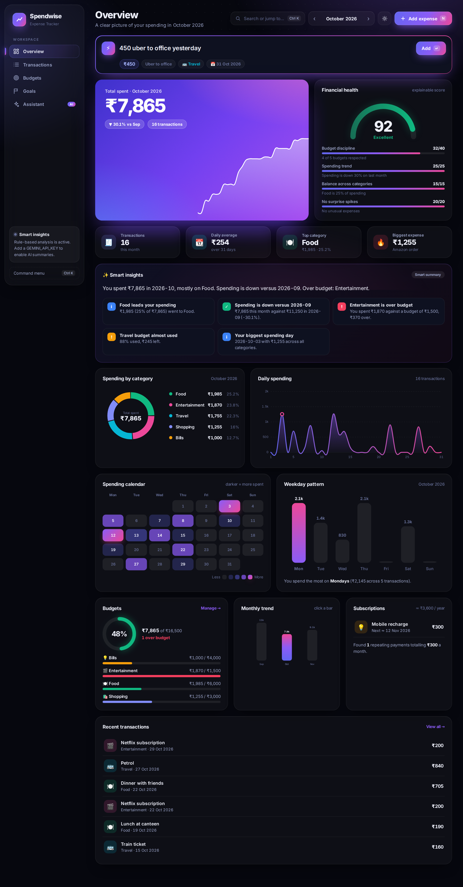
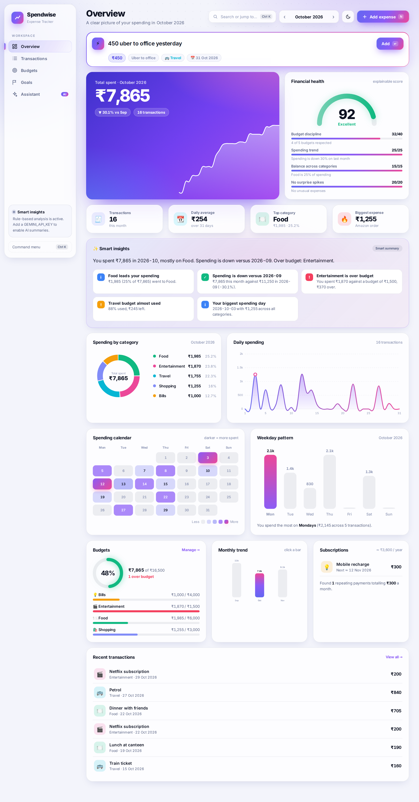
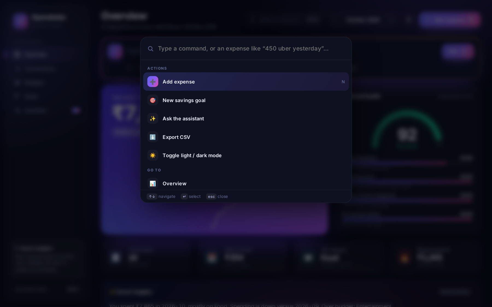
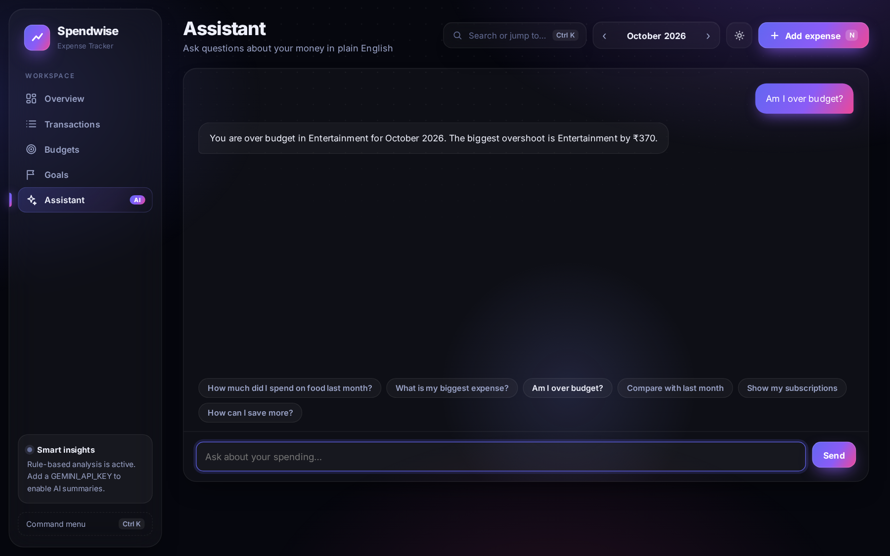
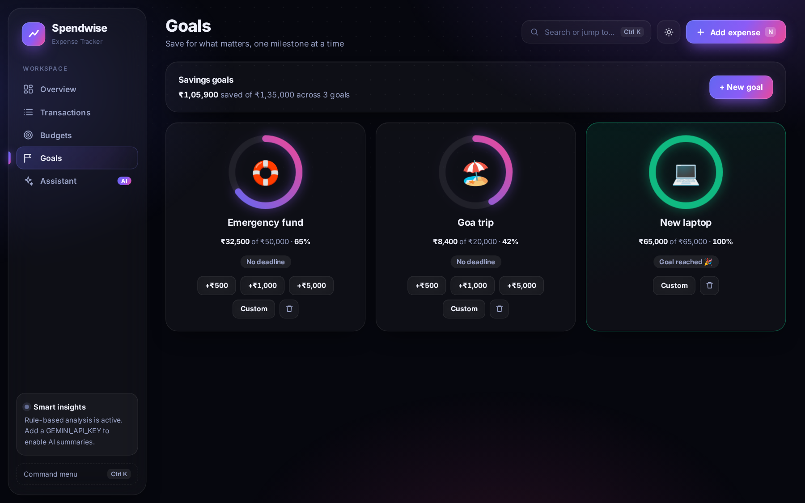
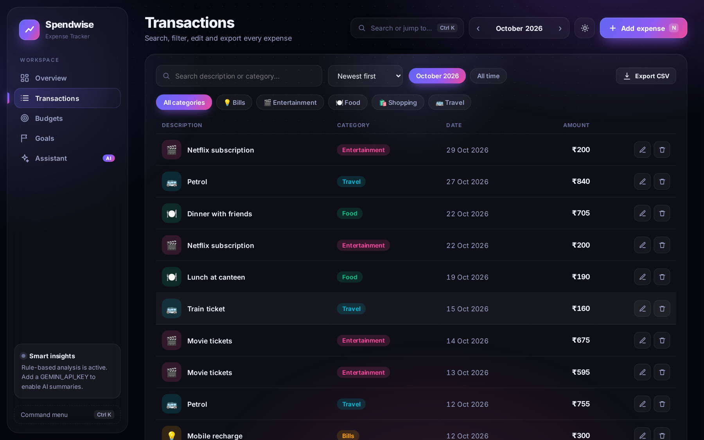
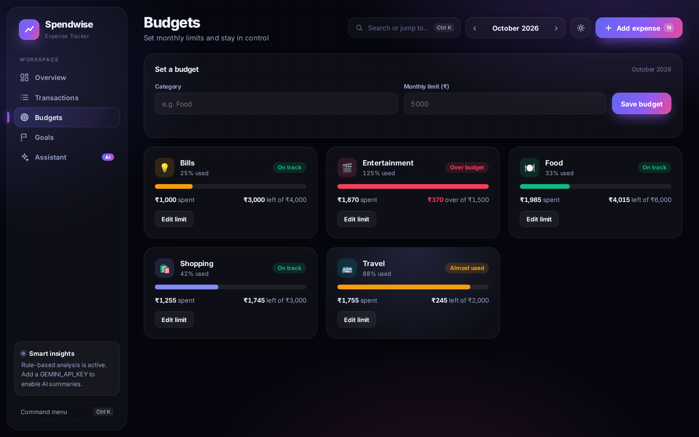
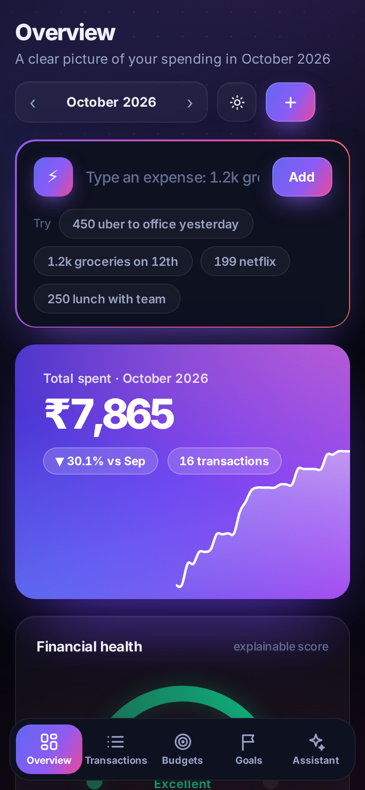

<div align="center">

# 💸 Spendwise — Expense Tracker

**A startup-grade personal finance app: natural-language entry, an AI assistant, budgets, savings goals and a financial health score.**
Built with Python, Flask and SQL, with a hand-crafted UI (no frontend frameworks, no chart libraries).




</div>

---

## ✨ What makes it different

| Feature | What it does |
|---|---|
| ⚡ **Quick Add (natural language)** | Type `450 uber to office yesterday` → amount, description, **category** and **date** are parsed live. Supports `1.5k`, `₹`, `rs`, `3 days ago`, `last friday`, `on 12th`, ISO dates |
| ⌘ **Command palette** (`Ctrl/⌘ + K`) | Jump anywhere, run actions, switch months, or quick-add an expense without leaving the keyboard |
| 🧠 **Financial Health Score** | A 0–100 score with an **explainable breakdown**: budget discipline, spending trend, category balance, surprise spikes |
| 💬 **Ask Spendwise (assistant)** | Ask in plain English: *"How much did I spend on food last month?"*, *"Am I over budget?"*, *"Compare with last month"*. Rule-based, works offline; Gemini is an optional fallback |
| 🔁 **Subscription detection** | Finds repeating payments from your history and shows the yearly cost |
| 🗓️ **Spending calendar + weekday pattern** | GitHub-style heatmap of your month and a chart of which weekdays you spend most on |
| 🎯 **Savings goals** | Targets with progress rings, deadline math ("save ₹4,000/mo"), quick-add funds and **confetti** when you reach a goal |
| 📊 **Insights engine** | Month-over-month change, budget warnings, month-end projection, **unusual-expense detection** (mean + 2σ per category) |
| 🧾 **Full CRUD** | Add, edit, delete with **Undo**, search, filter, sort, export to CSV |
| 🌗 **Polish** | Dark/light themes, glass UI with cursor spotlight, animated counters, responsive mobile layout with bottom nav |

## 📸 Screenshots

<table>
<tr><td width="50%"><b>Light theme</b><br></td>
<td width="50%"><b>Command palette</b><br></td></tr>
<tr><td><b>AI assistant</b><br></td>
<td><b>Savings goals</b><br></td></tr>
<tr><td><b>Transactions</b><br></td>
<td><b>Budgets</b><br></td></tr>
</table>

<p align="center"></p>

## 🚀 Quick start

```bash
git clone <your-repo-url> && cd expense_tracker
python -m venv venv && source venv/bin/activate     # Windows: venv\Scripts\activate
pip install -r requirements.txt
python web.py
```

Open **http://localhost:5000** and click **✨ Load sample data** (or press `Ctrl+K` and type "sample").

**Docker:** `docker build -t spendwise . && docker run -p 5000:5000 -v spendwise-data:/data spendwise`

**Optional AI:** set `GEMINI_API_KEY` to get AI-written summaries and answers to open-ended questions. Everything else works without it. Never commit your key (see `.env.example`).

### Keyboard shortcuts

| Key | Action |
|---|---|
| `Ctrl/⌘ + K` | Command palette |
| `N` | New expense |
| `/` | Focus Quick Add |
| `Enter` | Submit in Quick Add / modals |

## 🏗️ Architecture

```
┌────────────────────────┐   REST / JSON   ┌────────────────┐   SQL   ┌─────────┐
│ static/ (vanilla JS +  │ ──────────────▶ │ web.py (Flask) │ ──────▶ │ SQLite  │
│ CSS + hand-made SVG)   │ ◀────────────── │                │         │ 4 tables│
└────────────────────────┘                 └───────┬────────┘         └─────────┘
                                                   │
              ┌────────────────────────────────────┴───────────────────────────┐
              │ tracker/service.py    ExpenseTracker: CRUD, reports, budgets,   │
              │                       goals, export                             │
              │ tracker/insights.py   insights, category suggestion, AI w/      │
              │                       automatic rule-based fallback             │
              │ tracker/analytics.py  health score, recurring detection, NL     │
              │                       parser, question answering                │
              └──────────────────────────────▲─────────────────────────────────┘
                                             │ same service layer
                                       main.py (CLI)
```

```
expense_tracker/
├── web.py                  # Flask app factory + REST API
├── main.py                 # command-line interface
├── schema.sql              # categories, expenses, budgets, goals (constraints + indexes)
├── static/
│   ├── index.html          # app shell + dialogs
│   ├── css/app.css         # design system (themes, glass cards, animations)
│   ├── js/app.js           # views, SVG charts, command palette, quick add, assistant
│   └── fonts/              # bundled Inter (SIL OFL), works offline
├── tracker/                # db.py · service.py · insights.py · analytics.py · demo.py
├── tests/                  # 36 pytest tests (logic, API, analytics, parser, goals)
├── Dockerfile · .github/workflows/ci.yml
└── docs/                   # screenshots
```

## 🗄️ SQL & database design

```
categories(id PK, name UNIQUE)
expenses(id PK, amount CHECK > 0, category_id FK, description, expense_date, created_at)
budgets(category_id FK, month, limit_amount CHECK > 0)          -- composite PK
goals(id PK, name, emoji, target_amount CHECK > 0, saved_amount CHECK >= 0, deadline)
```

Techniques: `GROUP BY` with percent-of-total subquery, **CTE + `LAG()` window function** for month-over-month change, multi-table `JOIN`s, `INSERT … ON CONFLICT DO UPDATE` upserts, `CHECK`/`FOREIGN KEY` constraints, indexes.

```sql
WITH m AS (SELECT substr(expense_date,1,7) AS month, SUM(amount) AS total FROM expenses GROUP BY month)
SELECT month, ROUND(total,2) AS total,
       ROUND(100.0 * (total - LAG(total) OVER (ORDER BY month)) / LAG(total) OVER (ORDER BY month), 1) AS change_pct
FROM m ORDER BY month;
```

## 🧪 How the "smart" parts work (no black boxes)

- **Health score:** four transparent factors, 40 + 25 + 15 + 20 points. Each shows its own note, so the score is always explainable.
- **Subscription detection:** same description in 2+ months with amounts within 3% of each other.
- **Quick Add parser:** regular expressions for amounts (`₹`, `rs`, `k`), relative dates and weekdays; the category comes from a keyword scorer (or Gemini when enabled).
- **Assistant:** intent routing (totals, biggest expense, budgets, comparisons, forecast, subscriptions, tips) over the SQL layer. Numbers are never invented; the optional LLM only sees pre-computed facts.

## 🔌 REST API

| Method | Endpoint | Description |
|---|---|---|
| `GET` `POST` | `/api/expenses` | List (filter by `month`, `category`) / create |
| `PUT` `DELETE` | `/api/expenses/<id>` | Update / delete |
| `GET` | `/api/summary` · `/api/monthly` · `/api/daily` | Aggregations |
| `GET` `POST` | `/api/budgets/<month>` · `/api/budgets` | Budget status / upsert |
| `GET` | `/api/insights?month=` | Insights and summary |
| `GET` | `/api/analytics?month=` | Health score, weekday pattern, subscriptions |
| `GET` | `/api/parse?text=` | Natural-language expense parser |
| `POST` | `/api/ask` | Ask a question about your data |
| `GET` `POST` | `/api/goals` | List / create goals |
| `POST` `DELETE` | `/api/goals/<id>/contribute` · `/api/goals/<id>` | Add funds / delete |
| `GET` | `/api/suggest-category` · `/api/categories` · `/api/export` | Helpers and CSV download |
| `POST` | `/api/demo` | Load sample data (empty DB only) |

Errors are JSON (`{"error": "..."}`) with proper status codes (400 / 404 / 409).

## 🖥️ CLI

```bash
python main.py add 250 food "Lunch at canteen"
python main.py list --month 2026-10
python main.py summary --month 2026-10
python main.py budget-set food 2026-10 1000
python main.py export october.csv --month 2026-10
```

## 🧪 Tests

```bash
pytest -q        # 36 tests
```

## 🔭 Roadmap

PostgreSQL/MySQL support · user accounts & auth · income tracking · receipt OCR · PWA/offline mode

## 🛠️ Tech stack

Python · OOP · SQL (SQLite) · Flask · REST API · HTML/CSS/JavaScript · SVG data visualisation · NLP-style parsing · Gemini API (optional) · pytest · Docker · GitHub Actions

## 📄 License

MIT. See [LICENSE](LICENSE). Bundled Inter font: SIL Open Font License (`static/fonts/LICENSE.txt`).
